  

  
  
  

  

## About

Full-stack developer with hands-on experience building web applications with **React.js, Node.js, Express.js and MongoDB**. I have a strong grounding in the MERN stack and REST APIs from internships and real-world projects, and I'm looking to contribute to scalable software products while sharpening my engineering and problem-solving skills.

<table>
<tr>
<td width="50%" valign="top">

**Right now** 
Interning as an Advance Software Engineer at Grids Apps LLC, building a full-stack Dental Center Management System.

</td>
<td width="50%" valign="top">

**Studying** 
B.Tech in Computer Science Engineering (AI/ML) at JECRC University, Jaipur. CGPA 8.13.

</td>
</tr>
<tr>
<td width="50%" valign="top">

**Leading** 
Head of Information Technology & Data Analytics at IAESTE India LC JECRC, with a 7-member team.

</td>
<td width="50%" valign="top">

**Looking for** 
SDE roles and internships where I can work on scalable products.

</td>
</tr>
</table>

## Experience

<table>
<tr>
<td width="160" valign="top"><b>MAY 2026 — PRESENT</b></td>
<td valign="top">
<b>Advance Software Engineer Intern</b> · Grids Apps LLC (Remote) 
Contributing to a full-stack <b>Dental Center Management System</b>: implementing CRM workflows, appointment scheduling, authentication and database-driven features in a Git-based workflow. 
<code>React.js</code> <code>Next.js</code> <code>Laravel</code> <code>PHP</code> <code>MySQL</code> <code>REST APIs</code>
</td>
</tr>
<tr>
<td valign="top"><b>SEP 2024 — OCT 2026</b></td>
<td valign="top">
<b>Head, Information Technology & Data Analytics</b> · IAESTE India LC JECRC (Jaipur, On-site) 
Joined as a Local Committee Member and went on to lead the IT & Data Analytics department, managing web infrastructure and a 7-member team. Built an admin panel that <b>digitized 100% of workflows</b>, cut processing time from <b>2–3 days to under 2 hours</b>, and centralized data access for <b>600+ users</b>.
</td>
</tr>
<tr>
<td valign="top"><b>JUN — JUL 2025</b></td>
<td valign="top">
<b>Full-Stack Intern</b> · IAESTE Burundi (Remote) 
Developed and maintained the official IAESTE Burundi website, delivering responsive interfaces and improving accessibility across devices. 
<code>React.js</code> <code>Node.js</code> <code>Express.js</code> <code>REST APIs</code>
</td>
</tr>
<tr>
<td valign="top"><b>JUN — JUL 2025</b></td>
<td valign="top">
<b>Data Analysis Intern</b> · Samatrix Consulting Pvt. Ltd. (Remote) 
Worked on analytical and optimization projects across multiple domains: data processing, statistical analysis and business problem-solving on real-world datasets. 
<code>Python</code> <code>Pandas</code> <code>NumPy</code>
</td>
</tr>
</table>

## Projects

<table>
<tr>
<td width="50%" valign="top">

### TrackIt
<b>SMART EXPENSE TRACKER · MAR — APR 2026</b>

A full-stack expense tracking platform with JWT authentication, protected routes, RESTful APIs and analytics dashboards for monitoring spending.

<code>React.js</code> <code>Node.js</code> <code>Express.js</code> <code>MongoDB</code>

<!-- TODO: replace both links with the real TrackIt URLs -->
[Live demo](https://github.com/VikramS04?tab=repositories) · [Source code](https://github.com/VikramS04?tab=repositories)

</td>
<td width="50%" valign="top">

### Krishi AI
<b>FARMING SUPPORT APPLICATION · JUN — JUL 2025</b>

A full-stack agriculture support platform that combines machine learning models with backend APIs and a responsive interface to deliver real-time insights and recommendations.

<code>React.js</code> <code>Node.js</code> <code>Express.js</code> <code>MySQL</code> <code>ML</code>

<!-- TODO: replace both links with the real Krishi AI URLs -->
[Live demo](https://github.com/VikramS04?tab=repositories) · [Source code](https://github.com/VikramS04?tab=repositories)

</td>
</tr>
</table>

## Tech Stack

<table>
<tr>
<td width="170"><b>Languages</b></td>
<td></td>
</tr>
<tr>
<td><b>Frontend</b></td>
<td></td>
</tr>
<tr>
<td><b>Backend</b></td>
<td></td>
</tr>
<tr>
<td><b>Databases</b></td>
<td></td>
</tr>
<tr>
<td><b>Tools & Platforms</b></td>
<td> <code>cPanel</code></td>
</tr>
<tr>
<td><b>Concepts</b></td>
<td><code>Data Structures & Algorithms</code> <code>OOPs</code> <code>JWT Authentication</code> <code>API Integration</code> <code>REST APIs</code></td>
</tr>
</table>

## Certifications & Activities

<table>
<tr>
<td width="50%" valign="top">

**Certifications**

- Full Stack Internship Certificate · IAESTE Burundi (Jul 2025)
- Relational Databases and SQL · Udemy (Apr 2025)
- Data Structures and OOPs · Udemy (May 2025)

</td>
<td width="50%" valign="top">

**Extra-curricular**

- Core Team · Rising Rajasthan Global Investment Summit, Government of Rajasthan (Dec 2024)
- Bit By Bit Hackathon · Coginzance, IIT Roorkee (Mar 2025)
- Summer Reception Officer · IAESTE India LC JECRC (Summer 2025)

</td>
</tr>
</table>

## GitHub

<picture>
  <source media="(prefers-color-scheme: dark)" srcset="https://github-readme-stats.vercel.app/api?username=VikramS04&show_icons=true&hide_border=true&bg_color=00000000&title_color=a3e635&icon_color=a3e635&text_color=e4e4e7&count_private=true" />
  
</picture>
<picture>
  <source media="(prefers-color-scheme: dark)" srcset="https://github-readme-stats.vercel.app/api/top-langs/?username=VikramS04&layout=compact&hide_border=true&bg_color=00000000&title_color=a3e635&text_color=e4e4e7" />
  
</picture>

<picture>
  <source media="(prefers-color-scheme: dark)" srcset="https://streak-stats.demolab.com?user=VikramS04&hide_border=true&background=00000000&ring=a3e635&fire=a3e635&currStreakLabel=a3e635&currStreakNum=e4e4e7&sideNums=a3e635&sideLabels=e4e4e7&dates=a1a1aa" />
  
</picture>

<picture>
  <source media="(prefers-color-scheme: dark)" srcset="https://raw.githubusercontent.com/VikramS04/VikramS04/output/github-snake-dark.svg" />
  
</picture>

## Let's connect

I'm open to SDE roles, internships and collaborations on scalable software products. The quickest way to reach me is by email or LinkedIn.

  
  
  

